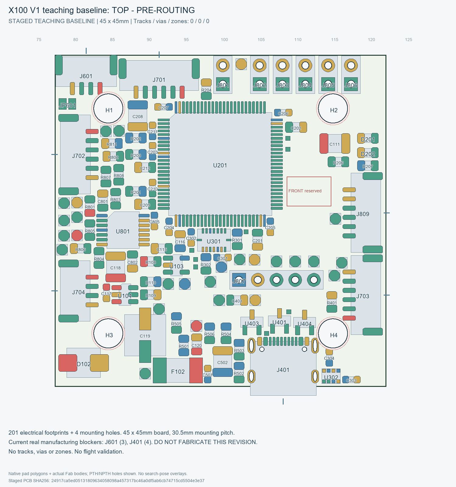
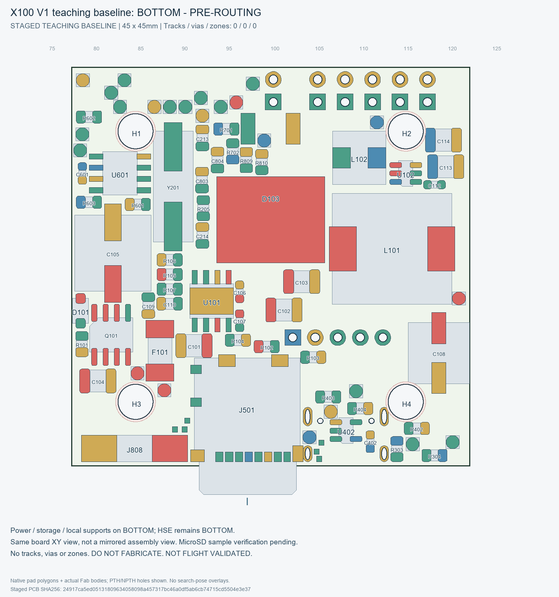

# X100 飞控硬件平台
## X100 Flight Controller

基于 STM32H743 / ArduPilot 的四层教学飞控硬件平台。

> **当前状态：PRE-ROUTING / 布线前阶段** 
> **不可直接制造：NOT FABRICATION READY** 
> **尚未飞行验证：NOT FLIGHT VALIDATED**

X100 面向第一次参与飞控硬件设计的本科生、研究生及课程接手者：用一块真实工程学习电源、传感器、通信接口、PCB设计和首板调试。ArduPilot 是后续软件目标，目前没有本板已验证的飞行固件。阅读从功能和接线开始，再进入原理图与制造规则。

当前人工接受的教学基线为 `X100_V1_PRE_ROUTING_TEACHING_BASELINE`，来源为 `PCB02C2_BLOCKER_CHECKPOINT`。原理图已完成受控ECO并冻结；201/201 个电气封装已放置，另有4个安装孔。四层PCB为 **45×45 mm**，安装孔距 **30.5×30.5 mm，Ø4 NPTH**，采用选择性双面装配。正式走线、过孔、铺铜均为 **0**。

**现在不能直接下单。** ERC 为0错误/0警告；J601有3条、J401有4条真实布线前阻塞，共7条，整板DRC尚未通过。先完成USB-only核心供电ECO裁决与安全审查，并关闭两个局部制造问题，再经人工批准进入PCB03布线；布线后还需DFM、CAM、首电、台架和飞行验证。

## 新增V1要求：USB独立核心供电（USB-only Core Power）

**当前公开baseline中，USB-only尚不能启动飞控核心。这是KNOWN DESIGN LIMITATION，不是最终X100 V1预期行为。** 当前USB-C为self-powered/data-only，USB_VBUS_RAW没有向5V_MAIN、3V3_MCU或3V3_SENSOR提供预定运行电源；没有VBAT/J808独立供电时，STM32H743不能按设计正常启动。不得把当前baseline直接当作最终USB供电方案。

人工新裁决：`USB_ONLY_CORE_POWER_SUPPORT=REQUIRED_FOR_V1`。未来必须仅插电脑USB、无VBAT即可完成MCU启动、USB设备枚举、DFU/bootloader/firmware flashing、ArduPilot刷写、地面站连接与参数配置、基础桌面调试及SWD/USB必要核心逻辑运行。**这些是需求，不是当前能力或已测试结果。**

推荐支持BMI088/SPL06-001核心传感器，但3V3_SENSOR完整域、microSD/3V3_SD是否一起供电必须由后续ECO的电流预算和供电架构裁决，本轮不假定。USB只用于CORE LOGIC / BENCH DEBUG POWER，不供ESC推进、电机、舵机、外部高电流5V、EXT_SWITCH_OUT大负载或其它动力负载。

`USB_ONLY_CORE_POWER_CURRENT_IMPLEMENTATION=NOT_IMPLEMENTED`；`USB_ONLY_CORE_POWER_V1_REQUIREMENT=REQUIRED`；`USB_POWER_ECO_REQUIRED_BEFORE_PCB03=YES`。这是功能/电源架构阻塞，独立于J601/J401共7条制造DRC。两处制造问题即使关闭，也必须先完成独立`USB_ONLY_CORE_POWER_ECO`并通过技术裁决，才能批准PCB03。接手顺序见[接手指南](HANDOFF.md)，详细边界见[电源架构](docs/POWER_ARCHITECTURE.md)。

## 硬件速览

| 中文功能 | 主要器件 / Reference | 型号及说明 |
| --- | --- | --- |
| 主控计算（MCU） | U201 | STM32H743VIT6，LQFP100 |
| 姿态与运动感知（IMU） | U301 | Bosch BMI088，六轴惯性测量单元 |
| 气压感知（Barometer） | U302 | Goertek SPL06-001，数字气压传感器 |
| 主5V电源（Buck Converter） | U101 | TPS54360B系列；正式订货型号TPS54360BDDAR |
| 数据存储（microSD） | J501 | Molex 1040310811，SDMMC1四位接口；样品机械核验待完成 |
| USB通信（USB FS） | J401 | GCT USB4105-GF-A；当前baseline仅数据/检测，USB-only供电待ECO |
| CAN通信（CAN Transceiver） | U601 / J601 | TI TCAN3414DR；JP601控制120Ω终端，默认OPEN |

其它功能包括GPS/TELEM/RC串口、外部I2C、六路PWM信号、板内电池电压采样、外部电流模拟输入、SWD调试、两只绿色指示灯及65个PCB测试点。功能已设计和放置，不等于已经实板验证；具体边界见功能成熟度表。

## 快速导航

| 从哪个问题开始 | 文档 / 工程 |
| --- | --- |
| 现在做到哪里 | [项目当前状态](STATUS.md) |
| 飞控有哪些功能 | [功能设计清单](docs/FEATURES.md) |
| 器件是什么、为什么采用 | [器件选型说明](docs/COMPONENT_SELECTION.md) |
| 实际需要买什么 | [元器件采购清单](bom/X100_V1_PROCUREMENT_LIST.csv) · [采购表使用说明](docs/PROCUREMENT_GUIDE.md) |
| 查正式源器件数据 | [工程BOM](bom/X100_V1_BOM.csv) · [元件状态](bom/component_status.csv) |
| 每个接口怎样接线 | [外部接口与引脚定义](docs/INTERFACES.md) |
| 理解各模块和四层布局 | [总体硬件架构](docs/ARCHITECTURE.md) |
| 区分动力与飞控供电 | [电源架构说明](docs/POWER_ARCHITECTURE.md) |
| 查制造与走线约束 | [PCB制造与布线规则](docs/PCB_RULES.md) |
| 查当前未解决的问题 | [当前已知问题](docs/KNOWN_ISSUES.md) |
| 第一次接手从哪里开始 | [接手指南](HANDOFF.md) |
| 怎样走到制造和验证完成 | [后续开发路线图](docs/ROADMAP.md) |
| 首板怎样安全上电 | [首板上电与Bring-up](docs/BRINGUP_PLAN.md) |
| 查专业词汇 | [中英文术语表](docs/GLOSSARY.md) |
| 查原厂资料与证据限制 | [资料来源](docs/SOURCES.md) |
| 打开KiCad | [工程目录](hardware/X100_V1/) · [正式工程文件](hardware/X100_V1/X100_CleanSheet.kicad_pro) |
| 在另一台电脑打开工程 | [可移植性](docs/PORTABILITY.md) |
| 查公开交接检查 | [仓库交接审计](docs/PUBLIC_REPO_AUDIT.md) |
| 了解许可边界 | [开放许可决定](LICENSE_DECISION.md) · [第三方说明](docs/THIRD_PARTY_NOTICES.md) |

使用KiCad 10.0.6或兼容的KiCad 10，并安装官方符号、封装与3D库。项目自定义库随仓库提供，路径保留ASCII英文，模块中文名称见总体硬件架构。

图中是布线前封装位置，不能作为已验收生产文件。公开仓库地址：[X100-Flight-Controller-Edu](https://github.com/chen123037/X100-Flight-Controller-Edu)。学生接手前请读[协作指南](docs/CONTRIBUTING.md)。

## 开放许可

- **Hardware license: CERN-OHL-P-2.0**：X100原创硬件设计源，完整官方文本见[LICENSE](LICENSE)。
- **Documentation license: CC BY 4.0**：项目原创教学文档，见[文档许可](docs/LICENSE_DOCUMENTATION.md)。
- **第三方库和资料**：遵循各自原许可证，详见[THIRD_PARTY_NOTICES](docs/THIRD_PARTY_NOTICES.md)；根LICENSE不覆盖受其它许可保护的第三方内容。

本仓库用于开放教学，允许在对应许可证条件下学习、下载、修改、制作和再分发衍生设计。许可适用范围见[开放许可决定](LICENSE_DECISION.md)。当前PRE-ROUTING、NOT FABRICATION READY、NOT FLIGHT VALIDATED状态继续保持；USB_ONLY_CORE_POWER_ECO、J601和J401关闭并经人工review后，才可申请PCB03授权。
