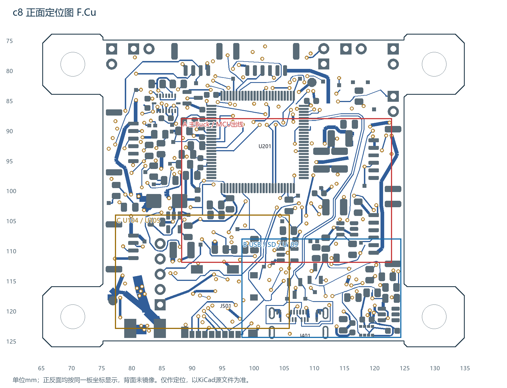
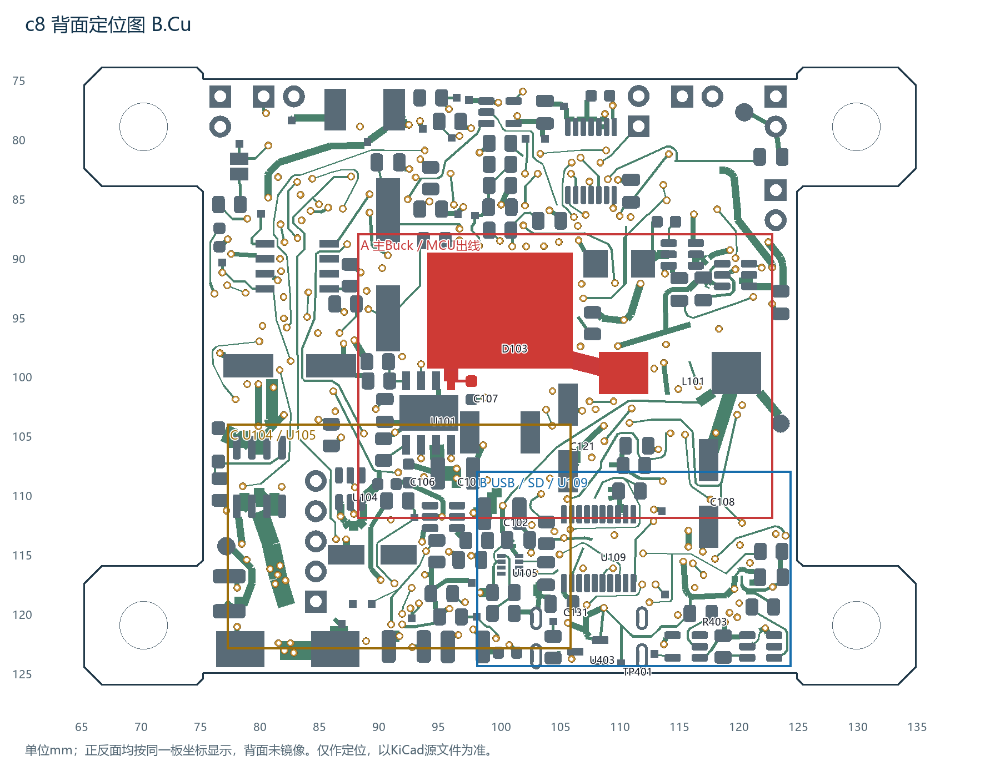

# X100 飞控硬件平台

基于 STM32H743 / ArduPilot 目标的四层教学飞控项目。

> **最新工作检查点：c8，布局/布线未完成，等待独立工程评审。**
> **NOT FABRICATION READY / NOT FLIGHT VALIDATED：不能下单，尚无实板及飞行验证。**

## 给帮忙看板的老师、师兄或PCB工程师

直接进入 [c8中文评审目录](hardware/reviews/X100_C8_LAYOUT_REVIEW/)，或[下载完整评审ZIP](hardware/reviews/X100_C8_LAYOUT_REVIEW/download/X100_中文评审包_c8.zip)。先读其中的中文PDF，再打开完整工程；[邀请文字和反馈模板](hardware/reviews/X100_C8_LAYOUT_REVIEW/04_评审反馈/)可直接转发。

我们请对方先判断：在保留现有器件、功能、四层及50×50主体的条件下，主Buck、MCU出线、U109/USB/SD和5V供电干线应怎样协同调整。请给具体摆放/通道意见，不用自动路由器失败证明板子必然不可布。本次是独立评审，不默认委托立即改完整板。

## 当前工程事实

| 项目 | 最新c8评审候选 |
| --- | --- |
| 源工程 | [X100_CleanSheet.kicad_pro](hardware/reviews/X100_C8_LAYOUT_REVIEW/01_KiCad工程_c8/X100_CleanSheet.kicad_pro) |
| 板形 | 电路主体50×50 mm；安装耳总外廓70×52 mm；四个Ø4 NPTH、孔距60×42 mm、双面Ø7安装包络 |
| 数量 | 240个总封装，已经包含65个测试点；双面贴装 |
| 布线 | 96项未连接；原理图一致性0；独立重跑ERC0 |
| USB | VBUS及CC已接通，DP/DM为F面0过孔；不等于USB-only启动、枚举、刷写或ESD已通过 |
| 未关闭 | 主Buck/MCU通道、共用5V干线、96项余线、3处铜区重叠、装配疑点、丝印及最终DFM |
| 装配证据 | 212对Courtyard几何重叠；其中6组二维焊盘/Fab凸包交叠，三维干涉均未确认 |
| 放行 | 没有可下单制造包；未采购、未下单 |

完整检查边界见[当前状态](STATUS.md)与[这几天工作说明](docs/C8_WORK_SUMMARY.md)。不能把ERC0、某类DRC报告0或局部几何筛查替代整板通过。载流、温升、约40pF耦合等均为带假设的估算，不是实测。

定位图按统一板坐标显示，背面未镜像；不是1:1制造图。

## 版本边界

- **当前供评审/后续工作的起点是c8目录。** c7回退随包保留。
- `hardware/X100_V1/` 保留此前201电气封装/205实体、45×45旧正式教学源，本次没有覆盖它；不应拿它替代c8继续工作。
- `hardware/proposals/` 中较早的282项未连接候选及其它阶段保留历史。不能把不同分支数字拼接成单一完成进度。
- 新安装耳方向已被接受；新增35个USB供电候选的具体型号/架构正式接受边界仍未关闭，发布评审候选不等于批准采购或制造。
- 当前分支用于评审；main保持人工接受基线，不自动合并。原理图/PCB及自定义库的60项源文件保持c8字节。

## 导航

| 需要什么 | 入口 |
| --- | --- |
| 请人帮忙看布局 | [中文评审包](hardware/reviews/X100_C8_LAYOUT_REVIEW/) |
| 目前做到哪里 | [STATUS](STATUS.md) / [工作说明](docs/C8_WORK_SUMMARY.md) |
| 从哪个工程接手 | [HANDOFF](HANDOFF.md) |
| 接下来怎样推进 | [ROADMAP](docs/ROADMAP.md) |
| 功能、接线和电源背景 | [功能](docs/FEATURES.md) / [接口](docs/INTERFACES.md) / [电源](docs/POWER_ARCHITECTURE.md) |
| 冻结制造数值与规则 | [PCB_RULES](docs/PCB_RULES.md)，当前实际以c8 PRO/DRU及后续裁决为准 |
| 当前候选BOM、测试点、网络表 | [检查证据](hardware/reviews/X100_C8_LAYOUT_REVIEW/03_检查证据/) |
| 首板验证 | [Bring-up计划](docs/BRINGUP_PLAN.md) / [USB首板计划](docs/FIRST_BOARD_USB_BRINGUP.md) |
| 许可和协作 | [许可边界](LICENSE_DECISION.md) / [第三方说明](docs/THIRD_PARTY_NOTICES.md) / [贡献流程](docs/CONTRIBUTING.md) |

旧文档中的“当前45mm、未开始布线、0走线/过孔/铜区”等描述，只对应其历史基线；最新状态以本页、STATUS、HANDOFF和c8证据为准。旧入口快照在[历史目录](docs/history/pre_c8/)。

## 开放许可

原创硬件源采用CERN-OHL-P-2.0，原创文档采用CC BY 4.0；KiCad派生库及第三方内容保持其原许可与例外。见[LICENSE](LICENSE)、[许可决定](LICENSE_DECISION.md)及[第三方通知](docs/THIRD_PARTY_NOTICES.md)。许可允许的制作权利不等于本工程已经达到制造或飞行安全要求。
