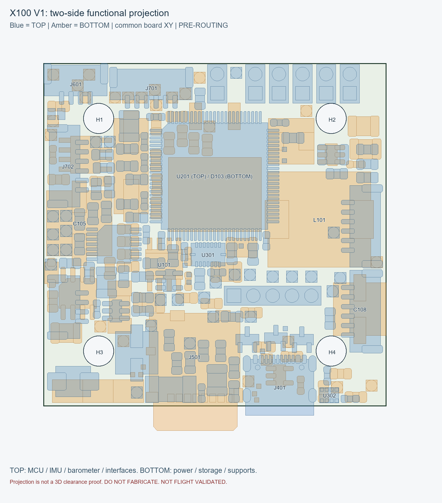

# 四层与选择性双面架构

4-layer提供连续GND参考与分层电源/信号空间；选择性双面装配把大功率／较高器件与MCU/IMU敏感区分开。功能分区按真实pads、Fab bodies、孔与插拔方向检查，不用文字或courtyard bbox替代实际机械几何。

TOP主要是MCU、BMI088、SPL06-001、接口及其局部支持。BOTTOM主要是电源、storage/support和passives；HSE固定BOTTOM。FRONT只保留空间，方向未冻结，不据此宣称已定义机体坐标。

45×45mm，30.5×30.5mm安装孔距，H1–H4 Ø4 NPTH。部分接口body/card边缘允许越过板边，需PCB铜支撑的pad仍必须满足制造边距；机架净空、插卡手指与线束路径需样品/装机验证。

WFG100A仅作为成熟architecture reference，借鉴四层、双面和功能分区原则；没有复制其坐标、footprint或38.5mm尺寸。该参考不证明本设计已经可制造、可飞行。

overlay使用共同board XY显示两面投影，不是装配视角镜像，也不是三维碰撞/净空验证。
