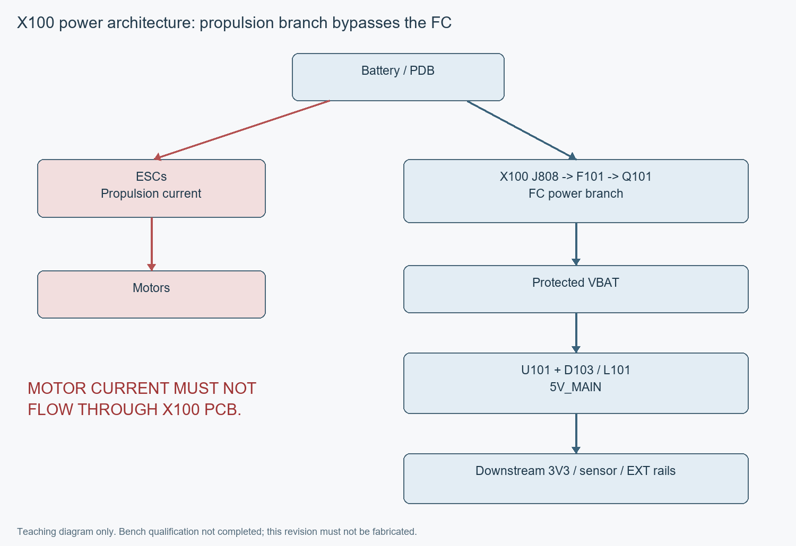

# 电源架构说明（Power Architecture）

电池到电机与电池到飞控是两条支路。**动力电机/ESC推进高电流严禁经过X100 PCB。** 飞控只从电池或配电板（PDB）分出独立低功率支路。

```text
动力路径：Battery / PDB ──→ ESC ──→ Motor
                 │
飞控路径：       └─→ J808 → F101 → Q101 → VBAT_PROTECTED
                                           │
                                           ├─→ D102 TVS → GND（并联瞬态保护）
                                           └─→ U101 + D103/L101 → 5V_MAIN
                                                                  ├─→ U102/L102 → 3V3_MCU
                                                                  │                └─→ R501 → 3V3_SD
                                                                  ├─→ 滤波 → U103 → 3V3_SENSOR
                                                                  └─→ U104 → F102 → EXT_5V
```

箭头表示能量路径，D103是Buck开关节点的续流整流部分，**不是串在电池输入线上的保险/反接件**。精确连接按原理图/Net核对。

| 器件 / 网络 | 中文作用 | 当前边界 |
| --- | --- | --- |
| J808 / VBAT_RAW | 飞控电源焊线正输入，pin2为GND | 3S–6S ONLY，既有输入包络9.0～25.2V；2S不支持 |
| F101 / VBAT_FUSED | 3A/125V输入熔断保险丝 | 不意味着可给ESC传输推进电流 |
| Q101 / VBAT_PROTECTED | P-MOS反接保护 | D101是栅源12V稳压钳位；D102才是26V双向输入TVS |
| U101 TPS54360BDDAR + D103 STPS8H100G-TR / L101 SRP1265A-100M | 主5V降压电源（Buck Converter） | 功率回路、补偿、启动、短路与温升待实板验证 |
| 5V_MAIN | 板内主5V | 工程稳态目标4.90～5.10V，不宣称动态/全温已验收 |
| U102 AP63203WU-7 / L102 SRN6045-4R7Y | 后级3V3_MCU | 给主控与相关逻辑；R501分出3V3_SD |
| U103 TPS7A2033PDBVR | 传感3V3低压差稳压器（LDO） | 输入为滤波后的5V_MAIN；3V3_SENSOR给BMI088/SPL06-001 |
| U104 TPS2553DBVR / F102 | 外设5V限流与PTC支路 | EXT_5V为所有相关接口共享1A设计总预算，非每口1A；开关/PTC/线缆会产生压降 |

输入瞬态、TVS、保险丝、线束电感及电容需联合验证，不能把芯片额定值、模型容量或保险丝电流当作整板通过。C105为50SVPF39M，Ø8mm、高11.9mm，底面机械净空尚待样品确认。

## 当前baseline：USB与调试器不替代飞控供电

**当前冻结baseline**的既有字段为`USB_BUS_POWER=DISABLED_FOR_V1`，这不是新增V1需求后的最终供电目标。J401的`USB_VBUS_RAW`仅用于独立ESD保护与检测，不连接5V_MAIN、3V3_MCU或3V3_SENSOR。在当前baseline中使用USB仍需独立电源；最终V1须经后续ECO实现USB-only核心供电。J807 pin1的3V3_MCU是调试器电压参考，不是电源入口；不能反向向EXT_5V灌电或短接限流开关旁路。

已知USB反灌前向拓扑路径通过硬件ECO关闭：U401为无外接VBUS steering供电脚的`TPD2E2U06QDBZRQ1`，U403独立保护VBUS，U404独立保护CC，U402执行VBUS逻辑检测。**ECO闭合仅是设计结论**；真实USB leakage、hotplug、TVS、overshoot及反灌台架验收仍未完成。首次接电脑前按[Bring-up计划](BRINGUP_PLAN.md)独立验证。



接线查[接口表](INTERFACES.md)，制造与上电放行查[路线图](ROADMAP.md)。

## 新增V1要求：USB独立核心供电（USB-only Core Power）

**当前公开baseline中，USB-only尚不能启动飞控核心。这是KNOWN DESIGN LIMITATION，不是最终X100 V1预期行为。** 当前USB-C为self-powered/data-only，USB_VBUS_RAW没有向5V_MAIN、3V3_MCU或3V3_SENSOR提供预定运行电源；没有VBAT/J808独立供电时，STM32H743不能按设计正常启动。不得把当前baseline直接当作最终USB供电方案。

人工新裁决：`USB_ONLY_CORE_POWER_SUPPORT=REQUIRED_FOR_V1`。未来必须仅插电脑USB、无VBAT即可完成MCU启动、USB设备枚举、DFU/bootloader/firmware flashing、ArduPilot刷写、地面站连接与参数配置、基础桌面调试及SWD/USB必要核心逻辑运行。**这些是需求，不是当前能力或已测试结果。**

2026-10-22用户选择方案1：尽可能支持BMI088/SPL06-001桌面检测与校准；microSD不作为USB-only强制负载，且不得妨碍MCU启动、USB与参数配置。若固件确实依赖SD，先报告再裁决。此处仅确认需求，未批准具体架构或器件。USB只用于CORE LOGIC / BENCH DEBUG POWER，不供ESC推进、电机、舵机、外部高电流5V、EXT_SWITCH_OUT大负载或其它动力负载。

`USB_ONLY_CORE_POWER_CURRENT_IMPLEMENTATION=NOT_IMPLEMENTED`；`USB_ONLY_CORE_POWER_V1_REQUIREMENT=REQUIRED`；`USB_POWER_ECO_REQUIRED_BEFORE_PCB03=YES`。这是功能/电源架构阻塞，独立于J401仍保留的4条制造DRC。两处制造问题即使关闭，也必须先完成独立`USB_ONLY_CORE_POWER_ECO`并通过技术裁决，才能批准PCB03。接手顺序见[HANDOFF](../HANDOFF.md)，详细边界见[电源架构](POWER_ARCHITECTURE.md)。

## USB_ONLY_CORE_POWER_ECO合同（正式方案尚未批准）

此需求文档不能当成已执行的ECO。保持`FORMAL_USB_HOST_BACKFEED_HARDWARE_EXCLUDED`原则：禁止USB_VBUS_RAW直接硬并5V_MAIN，禁止USB 5V与TPS54360B 5V直接并联，禁止未经reverse-current/fault分析直接用普通Schottky拼接，禁止重新引入5V_MAIN/3V3/VBAT→USB VBUS反灌。

后续优先审查专用power-path、ideal-diode、load-switch或reverse-blocking工程方案，具体IC尚不冻结。顺序为：候选架构→原厂数据手册核验→电流预算→fault-path分析→exact MPN裁决→最小schematic ECO→placement影响与安全review，不为少一个IC牺牲反向阻断、限流和双源安全。

### 明确供电域，不能写“USB给整板供电”

后续必须发布两张明确清单：`USB_ONLY_POWERED_RAILS`和`USB_ONLY_NOT_POWERED_RAILS`。当前没有USB-only运行供电轨；下表为**待裁决需求**，不是已经接受的新rail architecture。

| 现有rail / 负载 | USB-only需求边界 |
| --- | --- |
| 3V3_MCU / MCU核心、USB PHY、必要调试逻辑 | 必须满足核心启动/枚举/刷写/配置；路径、预算及必要支路由ECO定义 |
| 3V3_SENSOR / BMI088、SPL06-001 | 推荐支持核心传感器，但是否供完整域待预算/架构裁决 |
| 3V3_SD / microSD | 非强制负载，且不得妨碍核心；若实际固件依赖则先报告再决定 |
| 5V_MAIN | 是否/如何纳入核心电源管理待裁决，绝不能与USB_VBUS_RAW硬并 |
| EXT_SWITCH_OUT / EXT_5V / external 5V interfaces | 外部大负载默认不由USB供电；隔离/禁用方式须明确设计 |
| ESC propulsion / Motor / Servo / 其它动力系统 | USB禁止供电，仍走Battery/PDB→ESC→Motor独立动力路径 |

### USB_ONLY_CURRENT_BUDGET（待形成）

后续分别估算**startup、boot、idle、firmware flashing、normal configuration**，列出STM32H743、3V3 regulator losses、BMI088、SPL06、USB protection/sense、LED、其它core loads，以及SD（仅当决定USB供电）。推荐传感器若未纳入也需明确“未供电”，不能在预算中悄悄遗漏。

旧3V3 operating budget=0.889A是保守工程预算，**不是USB模式实测需求，禁止直接照搬**。当前仅有隔离候选及初算，未形成已通过预算或正式选型。USB2.0 device / Type-C UFP、CC1/CC2 Rd和no PD high-voltage request保持，未经另行裁决不加入USB-PD，不默认主机可供1.5A或3A；须依据合法USB/Type-C默认供电能力与实际分阶段电流预算设计。

### 电源安全审查必答项

USB VBUS输入保护、USB→core限流、USB/VBAT ORing或等价管理、reverse-current blocking、VBAT first/USB first、移除任一电源、host-off/VBUS low、rail sequencing、brownout/transition、插拔瞬态，以及故障状态禁止向PC反灌，都必须有数据手册、真实网表和故障路径证据。静态审查与后续实板测试分开，不能写USB POWER=PASS。

### 目标状态与实板验收矩阵（未来）

| 状态 | 输入/转换 | 必须验证的结果 |
| --- | --- | --- |
| A | No VBAT / No USB | 放电后全部rails off |
| B | USB only | MCU启动、USB枚举、DFU/bootloader/ArduPilot刷写、地面站配置与基础调试；批准core rails合格；无外部高电流rail启用 |
| C | VBAT only | 正常飞控运行，满足已批准电源合同 |
| D | USB first → then VBAT | 无rail fight、host backfeed、复位或破坏性瞬态 |
| E | VBAT first → then USB | 无host backfeed；USB正常attach |
| F | Both → remove VBAT | 若架构允许，批准核心安全由USB保持供电；后续必须明确连续性边界 |
| G | Both → remove USB | 由VBAT安全继续，无异常rail transient |
| Host-off边界 | 主机关闭 / VBUS low / 故障组合 | 无向PC反灌；限流、反向阻断、时序及brownout行为符合批准合同 |

当前目标未实现、未测。2026-10-22正在按授权清障，隔离候选及电流/SD/固件问题见[工程审查](USB_CORE_POWER_REVIEW.md)；具体架构与新器件仍须另行裁决。完整门槛见[STAGE USB-PWR](ROADMAP.md)。
