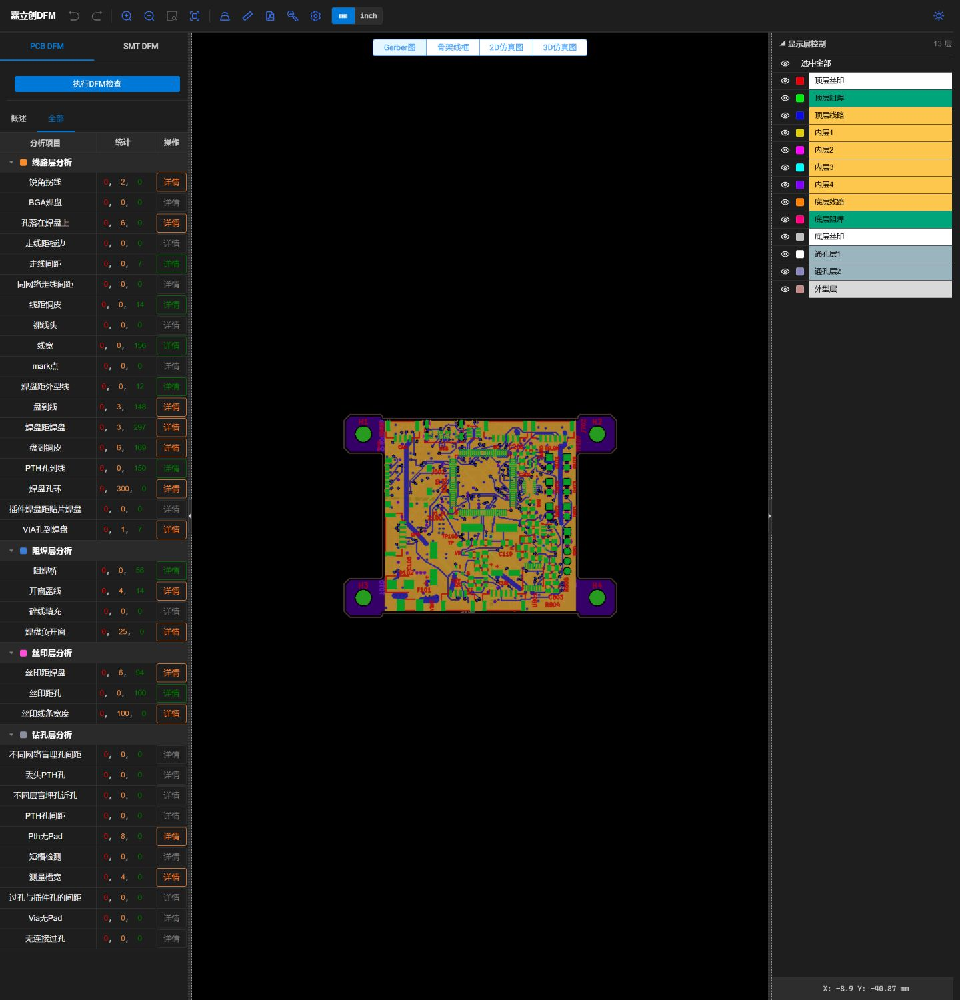

# X100 当前六层工程与 PCB 下单资料

**这是当前用于上传嘉立创创建PCB订单、提交工程审稿的资料版本：六层V4，PCB DFM所报危险0。** 当前制造ZIP与本次实际DFM上传文件逐字节一致。它不是旧c8，也不是旧45×45工程。

**当前没有宣告整板制造放行或飞行验收。** U101/D103整板热审查仍未签署通过，工厂实际叠层/填孔范围和生产稿也需确认；请保留这些真实边界，不把0危险写成全项PASS。

## 下载与打开

- [完整工程、制造文件、检查证据和购买清单ZIP](download/X100_六层当前版_工程制造及清单.zip)
- [仅Gerber/钻孔：本次实际DFM零危险ZIP](manufacturing/X100_6L_DFM_gap_silk_v4.zip)
- [KiCad10工程](project/X100_CleanSheet.kicad_pro)；11张原理图、自定义符号/封装库随附，保持相对库表。
- [嘉立创下单参数与六孔说明](manufacturing/嘉立创下单参数与六孔说明.md) · [六孔定位图](images/U101六孔_板厂定位图.png)
- [淘宝器件清单与完整MPN](procurement/) · [可筛选Excel](procurement/X100_当前淘宝器件清单.xlsx)
- [嘉立创原生PDF报告](evidence/JLC_DFM_NATIVE_REPORT_0_DANGER.pdf) · [全部原生计数](evidence/JLC_DFM_NATIVE_ALL_COUNTS.json)

使用KiCad10.0.6或兼容KiCad10，并安装官方标准库和3D模型。3D模型使用KICAD10_3DMODEL_DIR；原理图自定义库和PCB封装在project内。部分CAD标题栏/旧text_variables仍有历史HOLD或USB_MODE文字，发布过程没有为了改标题栏而重写源CAD；当前状态以本文和实际网表/检查为准。

## 当前核验事实

| 项目 | 结果 |
|---|---|
| 叠层与板形 | 6层、名义1.6mm、JLC06161H-3313；外廓约70×52mm，四个Ø4 NPTH，孔距60×42mm |
| 器件与测试点 | 174个PCB封装：144个功能位号、26个TP、4个孔；其中142个实例需采购，62种MPN |
| 布线/一致性 | 0未连接、0原理图一致性差异；2071条线段、332过孔、5块铜区 |
| ERC/DRC | fresh ERC0；DRC0错误，另56条库副本差异警告，未隐藏 |
| 原生PCB DFM | 35个结果行所报危险0、黄色468；计数沿用软件显示口径，不视为物理对象总数 |
| 未完成的接受 | 整板热设计、实际工厂工艺/生产稿确认；首板启动/温升/固件/无桨/飞行测试未执行 |

PCB SHA256：`09537241b43be8cdf2aa150a8214c6ce9225da4f3d8592bd108919dc2d73b529`。

实际DFM制造ZIP SHA256：`85254aca1ba4356953ddff8653cff87964dce0b77bb30dd6c1584126908b1bfc`。任务`DFMP2610310277`；包含6铜层、2阻焊、2丝印、板框、Gerber job及PTH/NPTH钻孔共14文件。

## 选工艺时必须明确

六层、1.6mm、外铜1oz/内铜0.5oz、沉金、绿油白字、高精字符，使用上述指定叠层。U101.9六孔必须树脂塞孔＋电镀盖帽填平，不能用普通盖油/塞油代替。原有USB两颗0.50/0.20mm过孔保持；其它新增孔采用0.60/0.30mm。

当前官方六层默认树脂塞孔盖帽的范围由工厂审稿列明，不能把连接器插孔、J401固定槽或安装孔塞住。J401原厂0.45mm有铜槽保持，不因通用DFM阈值加大；仅此槽宽阈值已按人工批准使用多层板0.35mm，其余规则保持。

原生PDF导出存在页面工艺表头回到默认喷锡的现象，PDF原样保留。**实际选择为沉金ENIG**，以Gerber job和[沉金页面截图](images/JLC_DFM_六层沉金_概述.jpg)核对，不能按PDF表头改喷锡。

## 本次发布范围

61项源CAD/库表逐字节复制，没有重新编辑PCB或原理图。最后局部修改只包括已批准的R113避让、重复红项相关过孔/支线和少量文字；具体读回证据在evidence。公开证据仅去除本机路径，原生制造ZIP、原生DFM PDF及源CAD不改字节。旧c8/旧正式源保留；本工作分支不自动合并main。

当前原生CPL仅供装联审查，尚未做贴片方吸附原点、底面角度、料号及面别验收；不能混用旧CPL。器件搜索清单也不是已验真淘宝商品或采购批准。

许可：原创硬件与文档沿用仓库许可；KiCad派生库保留原许可和例外。见[第三方说明](licenses/THIRD_PARTY_NOTICES.md)及下载包内licenses。
