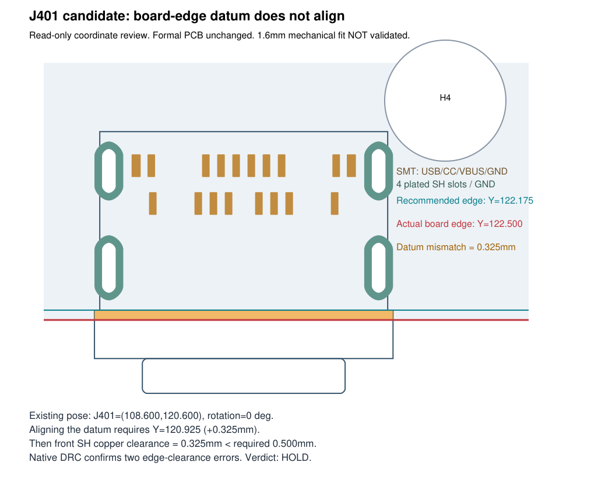

# J401 替换验证：HOLD，暂停正式替换

2026-10-22。用户批准继续验证，确认官网与立创商城对应记录、优先从立创采购，无须再查淘宝；**没有批准购买或写入正式原理图/PCB**。本次没有推广候选，也没有申请正式替换放行。

| 用户核查项 | 验证结论 |
| --- | --- |
| PCB Thickness 0.50mm 与 X100 1.6mm | **未闭合**。原厂产品页同时写 0.50mm 与 0.012in，换算不一致（0.50mm≈0.0197in；0.012in≈0.3048mm）。原厂 C12401977 rev3 第1页侧视图的0.50箭头表示贴装基面至固定脚底端距离，图纸解读为突出量；图中没有用这条尺寸标注安装板的两面。它不能直接证明只能用0.5mm板，也不能证明1.6mm板已获支持。1.6mm适配、短脚在较厚金属化槽内的焊接/强度要求须原厂明确。 |
| 官方land、固定脚、定位结构 | **平面名义几何核对通过，安装条件不通过**。16个信号/电源接点、2个midplate GND焊盘及4个SH金属化槽；没有塑料定位柱NPTH。SMT land以原图为准，0.25×0.75mm，两个midplate为0.30×0.75mm；4槽0.45×1.45/1.65mm、焊盘0.95×1.95/2.15mm，名义环宽0.25mm。外壳宽9.50mm、前缘凸缘9.85mm、侧视总深8.65mm、中心高1.50mm；中心高不能当总高度。原厂推荐layout还有±0.05mm公差。 |
| 45×45mm、J401位置、周围器件 | **当前候选不通过安装基准检查**。板边Y=122.500；候选J401 Y=120.600、角度0，官方PCB Edge局部Y=1.575，落在122.175，偏差0.325mm。原候选板材比推荐基准向连接口方向多伸0.325mm。现有二维实体/孔/引脚几何检查仍为0，但未覆盖板材与连接器三维下表面的干涉，不能继续解释成机械兼容。 |
| USB网络 | **通过保持性核对**。候选22个物理焊盘、17个逻辑编号逐个与正式PCB及XML一致：A6/B6=USB_DP；A7/B7=USB_DM；A5=USB_CC1、B5=USB_CC2；A4/A9/B4/B9=USB_VBUS_RAW；A1/A12/B1/B12/SH及midplate=GND；A8/B8仍NC。CC各自5.1k Rd及保护网络保持；本次未布线，因此不表示物理连通/USB信号完整性已通过。 |
| 最终DRC与板厂工艺 | **未通过**。原候选fresh native DRC629+411未连接；在隔离测试副本把J401移至Y=120.925以对齐官方PCB Edge后，fresh DRC631+411，新增2条SH铜到板边错误：0.325mm < 工程0.500mm。槽宽0.45名义上高于JLC多层板表格0.35，但该页说明另有0.5且槽公差为+0.13/-0.08mm，不能替代官方layout±0.05或exact CAM接受；尚无板厂DFM批准。 |

## 为什么撤回此前的推广建议

此前孔铜/实体局部结果没有覆盖官方PCB Edge与实际板边的一致性。这个遗漏已经由本次基准复核和native DRC对照发现；ERC0、旧孔铜错误消失、二维实体冲突0均不能作为安装适配结论。把原候选向板内缩以获得0.5mm铜边距，会偏离原厂推荐板边基准；对齐基准又会违反现有规则。未改板框、未削官方land、未申请局部例外，也未将原0.50mm规则全局放宽。

## 证据和复查

- 原厂 [产品页](https://www.amphenol-cs.com/product/124019772112a.html)、[C12401977 rev3图纸](https://cdn.amphenol-cs.com/media/wysiwyg/files/drawing/c12401977-3.pdf)、[SUSB014 RevB规范](https://cdn.amphenol-cs.com/media/wysiwyg/files/documentation/susb014.pdf)。SUSB014规定冲突时优先产品图，未找到对本型号1.6mm装配的明确许可。
- [JLC能力表](https://jlcpcb.com/capabilities/pcb-capabilities/)、[采购条目 C5430474](https://www.lcsc.com/product-detail/C5430474.html)。采购来源已确认，不等于装配适配已确认。
- `validation/J401_VALIDATION.json`：逐焊盘网络、尺寸、槽孔、两种姿态的几何、距离及54个正式CAD/库/规则文件散列。正式源54个文件保持，原正式J401仍为GCT。
- `validation/AS_PROPOSED_DRC.json` 与 `EDGE_ALIGNED_DRC.json` 是 KiCad 10.0.6 的原生全量报告。复查条件：复制本候选到隔离目录，保持同名PRO/DRU与45mm板框，仅将J401 Y从120.600改120.925。两处错误是前SH脚，中心(104.150,121.100)、(113.050,121.100)，pad高2.150，底缘122.175，距122.500板边0.325mm。
- 板框/固定脚/板材的三维关系、实际焊接强度、线缆/机架装配和在线DFM未通过，不以2D检查代替。

## 后续条件

**按用户指令：存在机械/制造风险即暂停，此候选停在HOLD。** 恢复本候选前至少需要原厂对1.6mm板厚、官方板边基准允许范围与固定脚焊接方式的明确资料，以及满足官方公差/工程规则的板厂CAM结论。未经新的明确授权，不改变板框/规则，不推广正式源，不购买；不另起型号替换或布线。
