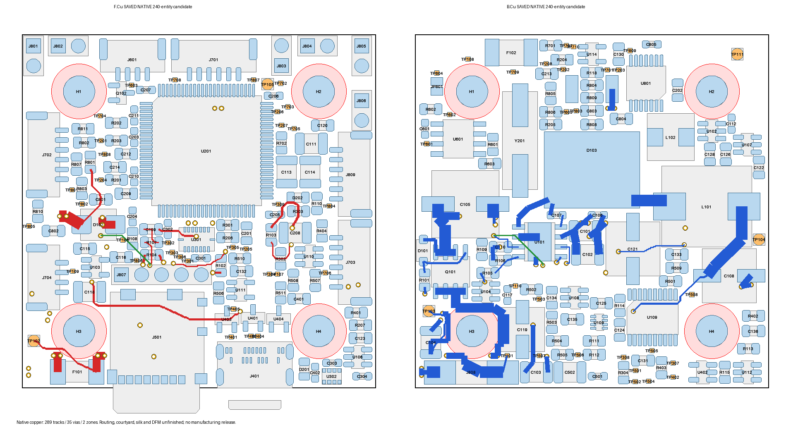

# X100统一候选：完整布局与主电源实际布线

打开 [KiCad工程](project/X100_CleanSheet.kicad_pro) / [PCB](project/X100_CleanSheet.kicad_pcb)。唯一工作候选，**不可投板**；未覆盖正式hardware/X100_V1。全部CAD修改由唯一指定的plant_kicad_v1执行。

截至2026-10-23，保存后的原生板已有 **289段铜线 /35个0.6/0.3mm标准过孔 /2个已填充铜区**：In1 GND、In2 VBAT_PROTECTED。236电气器件 /240实体（含65测试点、4孔）全部落板。35个新增器件仍属候选；BOM不是采购批准。

| 要求 | 当前结论 |
| --- | --- |
| USB_CORE_ARCHITECTURE_MINIMAL_SET | DEFINED；未正式采用 |
| ALL_FOOTPRINTS_WITHIN_45MM | YES |
| REAL_BODY_CONFLICTS | 0 |
| CONNECTOR_ACCESS | PASS；裸板标准插头/插卡、轴向路径、Ø7接触包络CAD范围 |
| CRITICAL_ROUTING_SPACE | REVIEWED；布局出口与关键预留通道 |
| FULL_PLACEMENT_READY_FOR_ROUTING | YES；已进入实际布线 |
| Current ERC /native parity | 0 /0 |
| DRC_FINAL /PCB_MANUFACTURING_PACKAGE | NOT_PASS /NOT_READY |

## 已实际写入的主Buck局部电路

VBAT_RAW连接器至保险丝、保险丝至保护MOS、MOS保护后输入储能/TVS/栅极偏置与所有VBAT_PROTECTED指定节点已接通。SW、BOOT、C101/C102/C106本地去耦、L101至C108输出、COMP/RC、RT、FB、EN及相关地连接均已写入原生铜线。[原生连接复核](evidence/ACTUAL_ROUTING_REVIEW.json) 按实际焊盘、铜线、过孔及含孔洞的填充多边形确认这些节点连通，未声称整板完成。

In2保护后输入平面采用局部0.50mm净距，保留原有补偿线，未降低或改名规避原有规则。实际填充后，同一连通铜区在源/目标过孔之间每0.01mm切片测得最小并行有效截面 **9.41mm**（要求8.3mm），四个主转接孔均完整接入。它是各并行分支截面的总和，**不是每一条连续分支都宽8.3mm**；切片中最大连续段的最小值约4.79mm，电流分配/热/过孔能力仍需最终审查，未标为电源安全PASS。[输入布线路径及铜区](evidence/INPUT_POWER_ROUTES.json)。

In1地铜已填充，主连续多边形约1759.65mm²，另有两处小多边形，最终回流/孤岛审查待完成。U101 EP/7脚、D103阳极、输入/输出电容及COMP/RT/FB/EN的指定地节点已确认同网连通。无VIP/HDI、无In1信号线、无全局规则放宽。

5V主输出干线1.5mm；0.25mm外层支线仅给R105分压器取样，不承载外部负载。使能控制颈线0.15mm，保持0.20mm铜间距。尺寸和连通性不等于电流/热/短路/稳定性验证PASS。

实际布线中，R104旋转180°；C102/C121/L101各右移0.35mm，打开U101使能脚出口，保留C101/C106本地去耦；TP304移出控制过孔出口。型号、引脚网络、45×45mm板框、Ø4孔/30.5mm孔距保持。保存后实体/跨面通孔/孔/铜距/板边问题0，同面元件Fab壳体最小间距≥0.20mm；正式57项CAD哈希未变。

## 布局审查范围

MCU↔IMU焊盘通道0.225→1.225mm。关键网络65条连接覆盖原生引脚：布线前56条有同时避让的计划路径，9条在保留功率/USB通道时独立确认出口。**这是进入布线的依据，不证明65条信号已同时布通。**详细路径冲突留在布线中重布；当前铜线以原生PCB和本页计数为准。[审查及局部调整](evidence/CRITICAL_ROUTE_SPACE_PARTIAL.json)。

四孔双面Ø7mm尼龙垫圈范围内器件、裸焊盘和过孔保持净空，器件名义余量≥0.10mm。少量常规盖油走线可经过尼龙垫圈下方；原生走线无阻焊开窗，过孔双面盖油状态均已读回，最终Gerber/阻焊仍需DFM复核。USB按USB-IF R2.4 Figure3-12的12.85×7mm插头包络检查，与插入卡片平面间距0.57mm。[连接器检查](evidence/CONNECTOR_REVIEW.json)限CAD范围，不含实物插拔/振动/机架放行。

旧USB/核心/主电源路径预检查各有原始源板哈希，属于历史布线前材料。主输入旁路已重布，当前对应[实际局部路径](evidence/MAIN_LOCAL_ROUTES.json)和[地连接](evidence/MAIN_GROUND_ROUTES.json)。USB 15.7mm双排合并支路仍需FS负载审查，尚无USB合规PASS。

## 未完成项

- 5V负载分配；随后3V3、HSE、USB、IMU、SDMMC、CAN与其余接口的实际布线。输入节点连通不替代最终电源/保护安全审查。
- 最坏负载/纹波/限流/热态裕量及回流/稳定性审查。USB-only普通A→C/C→C、枚举前电流、最小软件分阶段启动继续保留；理论预算不写成实测，启动/挂起/切换/热故障实测留bring-up。
- Fresh DRC有618条庭院/丝印/文字报告、438项未连接；庭院完整几何计数287对，不是本体碰撞，也不是DRC PASS。未缩庭院、批量排除或降全局规则。
- 最终机械/阻焊/丝印/DFM、JLC3313实际下单参数、BOM/CPL、Gerber/钻孔及投板审查包。

**未采购、付款、下单、合并main或正式采用新增USB电源器件。**投板仍须最终人工验收。

证据：[当前原生放置](evidence/PLACEMENT_REVIEW.json)、[ERC](evidence/ERC.json)、[DRC](evidence/DRC.json)、[网表](evidence/NET.xml)、[实际铜线与地连通](evidence/ACTUAL_ROUTING_REVIEW.json)、[BOM](BOM_CANDIDATE.csv)、[60项CAD哈希](evidence/CAD_SHA256.json)。

