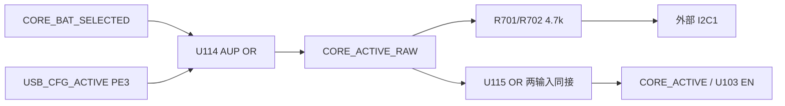

# USB-only Stage5 电气候选 — 未批准，未完成布局

当前正式源仍为 `hardware/X100_V1`。本目录是独立候选，不能整项目覆盖正式源，不能下单。唯一执行器 `plant_kicad_v1` 完成全部CAD写入。延续Stage4的USB限流、双源mux、受控slew、复位、SD电源/总线隔离及68.1k PG阈值；不采用尚未批准的紧凑晶体/电感。

## 本次实际变化

外部I2C的两只4.7k上拉原先始终连MCU3.3V，总线被拉低时约消耗1.4mA。候选把它们的上端改接 `CORE_ACTIVE_RAW`，由现有的VBAT选择/USB配置状态控制。R值、MCU95/96脚、J701/J704共享总线、测试点及既有3.3V接口规则保持（既有接口禁止5V上拉）。关闭时是4.7k弱下拉，**不是总线断电隔离器**。

U114/U115使用同一候选 **TI SN74AUP1G32DBVR / C469878**。U115隔开上拉负载与传感器LDO使能；新增一只门和C137100n旁路，复用已选KEMET C0805C104K5RACTU/0805。没有增加MCU GPIO，没有与SD卡PG共用I2C使能。新门型号、数量和完整电源架构均未正式批准。

同时恢复 `3V3_MCU→R207→D202→GND` 的独立硬件电源指示。它不依赖枚举/固件/传感器使能。R207改10k，复用已选RC0805FR-0710KL；按3.33V、R值与温度合计2%保护假设、LED零压降，电流上界计算0.340mA。2.1V压降敏感性估计约0.12mA；原厂20mA亮度/VF数据不保证这个低电流下的可见性，首板须检查。

## 核验范围

| 项目 | 当前候选结果 |
| --- | --- |
| 元件 / PCB实体 | 242电气器件 +4孔 =246；比Stage4增加U115、C137 |
| fresh ERC / native parity | 0错误0警告 /0问题 |
| 正式源既有引脚改网 | 精确28处；Stage4比较仅R701.1、R702.1、U114.4及R207.1四处 |
| PCB pin/net、value、footprint、path | 逐项核对，差异0 |
| 既有位置 | 已通过执行器重放当前正式205实体姿态，包含MCU右移与既有孔位/连接器更新 |
| 正式源/Stage4父源 | CAD逐文件哈希保持 |
| 布局 / 布线 | **41个新增封装仍在原点；0 tracks/vias/zones** |
| 全板DRC | 1528条报告、453未连接；分类报告有上限，绝非通过 |

首次执行器只读试排固定205个旧实体、尝试分配41个新封装；原生复核仍发现新增194对庭院重叠及115处实体冲突，已拒绝应用，PCB字节保持。原始位置建议及拒绝记录见 `PLACEMENT_DRY_PROPOSALS.json`、`PLACEMENT_DRY_REJECTED.json`。这个局部试排失败不证明45mm板框整体无解；仍需功能块/双面分配与必要局部重排。

ERC和同步通过只证明上述电气结构，不能替代新部件放置、实际功率回路、制造或实物测试。原共享上拉电源线切分后的悬空线已按ERC位置通过执行器删除，没有关闭检查规则。

## 逻辑与电流边界

[AUP原厂](https://www.ti.com/lit/ds/symlink/sn74aup1g32.pdf)的3V/2.7mA测试工况在-40..85°C给出VOH≥2.67V、VOL≤0.33V；本次3.0..3.6V设计筛查的两路上拉与缓冲输入负载约1.564mA。数据手册测试值用于最低供电侧筛查，不扩展成整板任意温区保证。两门的输入输出级匹配见 `LOGIC_SCREEN.json`。

U115轻载低电平用0.1V工况筛查，对[TPS7A20](https://www.ti.com/lit/ds/symlink/tps7a20.pdf)的低输入要求0.3V留余量；原始加载门的0.33V工况不能直接充当该LDO可靠关闭证明，因此保留缓冲。AUP的0.6µA Ioff/DeltaIoff、0.9µA ICC各有原厂电压/输入/温区条件，不能当作整板所有状态电流上界。1.8µA新增相关引脚及既有8µA ADC贡献按R81110.2k估计约0.100V，只是局部漏电估计；MCU直接GPIO及外设供电等路径尚须检查，未宣称整个接口掉电隔离通过。

预算保持80%转换效率、25mA额外PHY等明确工程假设。新增PWR灯保守预留后，active控制余量按3.9mA；预配置关闭本地I2C上拉供电后按2.5mA筛查。100MHz sleep典型比例估计原始USB约35.931mA，加30%为46.71mA；**这不是启动保证或实测**。200MHz sleep最大值代入的25°C上界案例仍约61.054mA，高于限流最小角落50mA，失败行完整保留。挂起2.5mA、启动、枚举、刷写、源切换等资格验证仍未完成。

固件仍需落实既有PE3状态钩子：低电流阶段关闭PB0状态灯；挂起/撤配置前停外I2C、GPIO analog/no-pull，再清PE3；USB唤醒路径保持；恢复后重建/恢复外I2C和传感器。双口同时连接、自供电外设、线缆电容、上升时间、输入缓冲电流、冷态注入和PWR灯亮度均纳入首板计划。未购买/要求额外开发板，也没有用典型值写实测PASS。

`POWER_SAFETY_REVIEW=NOT_COMPLETE`；`USB_CURRENT_QUALIFICATION=NOT_DONE`；`FABRICATION_READY=NO`。下一步完成全部新封装放置、最小BSP实际实现/审查、预算与故障路径，获批具体方案后才差异集成正式源并完成布线/制造包。
